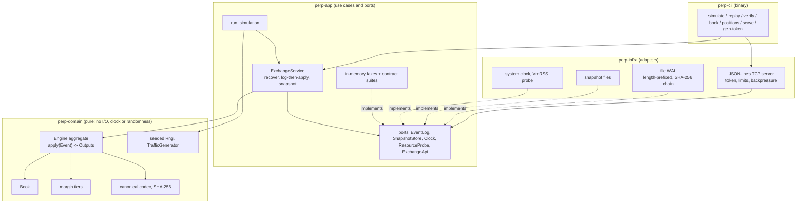

# perp-engine

An **educational** perpetual-futures exchange core in safe Rust: a deterministic
matching engine, cross-margin accounting, funding, liquidation with an insurance
fund and auto-deleveraging, and a crash-safe event log with exact replay.

> **Not for real funds.** This is a learning project by one person. It has not
> been audited, has no users, no customers and no production deployment, and is
> not affiliated with any exchange. It is **not a clone** of any venue, uses no
> code or proprietary material from any venue, and has no consensus, L1, wallet
> or oracle-security layer. It models the parts of a perp venue that are easy to
> get subtly wrong (integer money, priority rules, margin, funding, liquidation,
> replay) and tests them hard. Read [Limitations](#limitations) before using any
> of it for anything.

## What is and is not modelled

| Modelled | Not modelled |
|----------|--------------|
| Fixed-point price, size and money types, checked arithmetic, documented rounding | Floating point (deliberately absent), multiple collateral assets |
| Order book with price-time priority, limit GTC/IOC/FOK/post-only, market orders with a slippage limit, reduce-only, cancel, cancel-replace, self-trade prevention, tick/lot/min-notional | Iceberg, stop and trigger orders, order modification of side/market, batch auctions |
| Cross-margin accounts, tiered margin schedule, max leverage, maker/taker fees with rebates, deposits and margin-checked withdrawals | Isolated margin, portfolio margin, sub-accounts, fee tiers driven by volume |
| Oracle events with staleness checks and a bounded change filter, mark price, premium-based funding with a clamp and an exact zero-sum split | Oracle security, multiple sources, TWAP windows |
| Liquidation by IOC orders at a documented price rule, insurance fund, simple deterministic auto-deleveraging, bad-debt reporting | Liquidation auctions, partial fills by external liquidators, real ADL ranking by leverage |
| Event-sourced state machine, write-ahead log with SHA-256 hash chain and torn-write repair, snapshots, state hash | Replication, consensus, multi-writer logs, log rotation |
| CLI, deterministic traffic simulator, JSON-lines TCP server on loopback with a token | TLS, per-user permissions, a public API, a UI |

## Architecture

The code follows a layered design (domain-driven): a pure domain, an application
layer of use cases and ports, and adapters. Each layer is a Cargo crate, so the
dependency rule is enforced by the compiler; an architecture test also checks the
manifests. See [docs/domain.md](docs/domain.md) for the glossary and the context
map and [docs/adr](docs/adr) for the decisions.



```
perp-cli  ->  perp-infra  ->  perp-app  ->  perp-domain
```

| Crate | Layer | Contains | Third-party deps |
|-------|-------|----------|------------------|
| `perp-domain` | domain | fixed-point values, `Engine` aggregate, book, margin, funding, liquidation, codec, SHA-256, seeded RNG, traffic generator | none (not even `perp-*`) |
| `perp-app` | application | ports, `ExchangeService`, simulation use case, in-memory fakes, shared contract suites | none |
| `perp-infra` | adapters | file WAL, snapshot files, strict JSON, protocol, TCP server, token, clock, memory probe | none |
| `perp-cli` | adapters | the `perp-engine` binary, benchmark, end-to-end and architecture tests | none |

`Cargo.lock` lists exactly these four crates: no third-party crates, no build
scripts, no proc macros, and `#![forbid(unsafe_code)]` in every crate.

### How an event flows

1. `ExchangeService::submit` stamps the event with a non-decreasing time (the
   clock is a port; the domain never reads one).
2. The event is appended to the log **first** (`fsync` per policy).
3. `Engine::apply` validates, then mutates. A rejected event changes only the
   applied-event counter and is still in the log, so replay reproduces rejections
   too. An error after mutation began halts the engine (fail-stop) instead of
   continuing on corrupt state.
4. Outputs (fills, cancels, funding, liquidation, ...) are returned.
5. Every N events a snapshot is written; recovery = newest valid snapshot + replay
   of the log tail.

## Quick start

Everything is built and tested in a throwaway container; no Rust is needed on the
host. Docker pulls the pinned toolchain on first use.

```sh
scripts/container.sh cargo fetch --locked
scripts/container.sh scripts/run-layers.sh          # all layers, one after the other
scripts/container.sh scripts/coverage.sh            # coverage table (see below)
scripts/container.sh cargo build --release --locked
scripts/container.sh /target/release/perp-engine simulate --events 200000
```

With a local toolchain the same commands work without the wrapper
(`rust-toolchain.toml` pins 1.95.0 with rustfmt, clippy and llvm-tools).

```text
perp-engine simulate [--seed N] [--events N] [--accounts N] [--markets N]
                     [--dir DIR] [--fsync always|every:N|never]
                     [--snapshot-every N] [--checkpoints N] [--check-every N]
perp-engine replay <wal>                 replay a log and print the final state
perp-engine verify <wal> [--strict]      hash chain + replay + invariants
perp-engine book <wal> [--market N] [--depth N]
perp-engine positions <wal> [--account N]
perp-engine serve --dir DIR [--listen ADDR] [--token-env NAME | --token-file PATH]
                  [--allow-non-loopback] [--init] [--markets N]
perp-engine gen-token [--out FILE]
```

### A real simulation run

`simulate` generates seeded order flow from five trader behaviours (market maker,
noise taker, trend follower, leveraged whale, churner), pushes every event through
the durable service into a real file log, then `verify` re-reads the log. Output
of `simulate --dir /tmp/simdir --seed 1 --events 200000 --accounts 200 --checkpoints 50000 --fsync never --snapshot-every 50000`
followed by `verify /tmp/simdir/engine.wal --strict` (release build, container):

```text
log: /tmp/simdir/engine.wal
simulation: seed 1 accounts 200 markets 1 events 200000
bootstrap events      270
generated events      200000 (accepted 182887, rejected 17113)
rejections            fok_not_fillable=7557 invalid_price=362 margin_breach=1397 no_liquidity=6364 unknown_account=401 unknown_order=408 would_cross=273 zero_qty=351
orders rested         54760
fills                 82655
self-trade cancels    71
funding settlements   68
liquidation steps     139
auto-deleveraging     0
insurance fund        49868.581637
fee pool              35929.708882
bad debt              0.000000
checkpoint     50000 events: resting orders      2, accounts with positions  196, rss 2464 KiB
checkpoint    100000 events: resting orders      1, accounts with positions  195, rss 2464 KiB
checkpoint    150000 events: resting orders      2, accounts with positions  195, rss 2464 KiB
checkpoint    200000 events: resting orders      4, accounts with positions  195, rss 2464 KiB
state hash            2712050a4d128c4a5b438177616cda0cb0a9ab9b5e5df75f349e0d616e68fd0f

records               200270
file length           18076731 bytes
chain head            4cb0fb1a69a2f0e0174946cd8f41026cdbd6a2acd08e818491c50735059ce4e3
torn tail             0 bytes
state hash            2712050a4d128c4a5b438177616cda0cb0a9ab9b5e5df75f349e0d616e68fd0f
OK: chain valid, replay deterministic, invariants hold
```

The state hash printed by `simulate` equals the one `verify` recomputes from the
file by replay. 17 113 of the 200 000 generated events (8.6%) are rejected: the
generator deliberately emits about 0.8% invalid events (zero quantity, off-tick
prices, unknown accounts and orders), and the rest are margin, liquidity and
fill-or-kill outcomes. Auto-deleveraging does not occur in this flow because the
insurance fund always covers the deficits; the liquidation tests build the cases
that exhaust the fund.

## Money conservation, by test

The engine keeps one exact identity after **every** event (checked by
`Engine::check_invariants`, which runs in the property tests, after snapshot
decode and in `verify`):

```
sum(collateral) + insurance + fee_pool - sum(cost basis) == net_deposits + bad_debt
```

`net_deposits` is deposits minus withdrawals plus insurance funding. When all
positions are flat the cost basis is zero, so collateral plus the two pools equals
the money that came in. Positions carry a *money* cost basis, so each trade moves
`collateral - basis` by exactly zero over its two counterparties (ADR 3).
`bad_debt` is zero unless a loss was uncovered; then it is reported, not hidden.

| Property | Where it is checked |
|----------|---------------------|
| Money identity holds after random flow (300k+ events, three seeds, checked every 500 events) | `properties.rs::invariants_hold_over_300k_events_across_seeds`, `money_in_equals_money_out_plus_fees_and_insurance` |
| Money identity after scenarios: fees, rebates, flips through zero, withdrawals | `accounts_margin.rs` (`assert_conserved`), `order_matching.rs` |
| Money identity through liquidation, insurance payout, ADL, bad debt | `liquidation.rs` (`identity`) |
| Funding is zero-sum, remainder carried explicitly | `oracle_funding.rs::funding_is_zero_sum_with_several_accounts_and_odd_amounts`, `engine::funding` unit tests |
| Order book never crossed | `properties.rs` (every event), `order_matching.rs::book_is_never_crossed_under_a_deterministic_mixed_sequence` |
| Position sizes sum to zero per market | `properties.rs::position_sizes_sum_to_zero_in_every_market`, enforced on decode |
| No underwater account without liquidation having run | `properties.rs` (`underwater_accounts` vs `LiquidationStarted`), `liquidation.rs` |
| Replay of the log gives the identical state hash | `properties.rs::replay_of_the_log_reproduces_the_state_hash`, `perp-infra/tests/wal_recovery.rs` |
| Snapshot + tail equals full replay | `properties.rs::snapshot_plus_tail_equals_full_replay`, `wal_recovery.rs::snapshot_recovery_equals_full_replay` |
| Rejected events change nothing but the counter | `properties.rs::rejected_events_change_only_the_counter` |
| Torn-write recovery at every byte offset of a 30-event log | `wal_recovery.rs::recovery_after_a_crash_at_every_byte_offset_of_the_log` (plus `perp-infra` unit tests on a 40-record fixture) |
| Hostile inputs (overflow, zero sizes, cancel storms, extreme timestamps, 200k garbage events) | `adversarial.rs` |
| Memory plateaus | `perp-cli/tests/memory.rs` |

## Tests by layer

687 tests, all deterministic, no network beyond loopback, all in temp dirs.

| Layer | Kind | Tests |
|-------|------|-------|
| Domain (`perp-domain`) | unit tests of values, book, margin, codec, hashing | 75 |
| | aggregate scenarios: matching (82), accounts and margin (42), oracle and funding (38), liquidation and insurance (44) | 206 |
| | state codec and hash (35), adversarial and fuzz (43), property tests (7), smoke (1) | 86 |
| Application (`perp-app`) | use cases on in-memory fakes (service, recovery, simulation) and the port contract suites against the fakes | 60 |
| Adapters (`perp-infra`) | unit tests (JSON, protocol, token, WAL, snapshot, clock, probe), contract suites against the real file adapters, TCP server tests (48), WAL recovery (23) | 232 |
| CLI (`perp-cli`) | argument and rendering units (8), architecture (6), end-to-end on the real binary (12), memory (2) | 28 |

Domain tests exercise the aggregate through its public API: every rule has a
passing and a rejecting case with an exact `Error` asserted, and every domain
event (`Output`) is checked to be emitted exactly when expected. Application
tests use only in-memory fakes. The same *contract suite* (`perp_app::contract`)
runs against the fakes and the real file adapters, so a fake cannot drift from
the real thing. End-to-end tests run the real binary: simulate, replay, verify,
corrupt and truncate logs, `serve` over TCP, kill the process and restart.

`scripts/run-layers.sh [domain|application|adapters|e2e]` runs one layer at a time.

### Coverage

Measured with rustc's source-based instrumentation (`-C instrument-coverage`) and
`llvm-profdata`/`llvm-cov` from the `llvm-tools` rustup component; no third-party
crate. `scripts/coverage.sh` runs the whole workspace instrumented and prints line
coverage per layer. Inline `#[cfg(test)]` modules are excluded from the numbers
(everything from the first `#[cfg(test)]` line to the end of a file), and `tests/`
and `benches/` are never counted.

```text
layer               lines  covered  percent
domain               3632     3554   97.85%
application           652      636   97.55%
infrastructure       2362     2250   95.26%
cli                   481      450   93.56%
all                  7127     6890   96.67%
```

Targets were 95% (domain), 90% (application), 85% (overall). What is **not**
covered, honestly (run `scripts/coverage.sh --uncovered` for line numbers):

* `Display`/`Debug` formatting of a few error types and the redaction of the
  `Auth` request in `Debug`.
* Defensive branches that return `Error::Internal` or halt the engine
  (`Halt::Funding`, `Halt::Adl`, "fee pool went negative"): they guard
  invariants that the other code establishes, so no input reaches them.
* WAL "poisoned after a failed fsync" and mid-write rollback paths: forcing a
  write or fsync failure portably needs fault injection, which this repository
  does not have.
* Server paths for a panicking backend thread and a few socket-error branches.
* CLI branches for failed writes to stdout/stderr.

Line coverage says the code ran, not that the assertions were strong; the
invariant and property tests carry the weight.

## Benchmarks

`cargo bench --bench throughput` (std only, `Instant`; no criterion). It records a
seeded event stream once (400 270 events: 200 accounts, one market, 348 498 order
placements) and replays it for each measurement, so every variant does identical
work. Latency is the time around one `Engine::apply` call (the `Instant` pair
itself costs tens of nanoseconds).

Host: a Linux aarch64 container (Docker on an Apple-silicon Mac, 12 vCPUs, 24 GB
RAM visible), release build with `overflow-checks = true`, single thread. **The
machine was shared with other builds while I measured (load average about 17), so
the three runs differ a lot.** Best run and range over three consecutive runs:

| Measurement | Best run | Range over 3 runs |
|-------------|----------|-------------------|
| engine only, events/s | 749 912 | 245 683 - 749 912 |
| engine only, order placements/s | 652 917 | 213 906 - 652 917 |
| `apply` latency, order placements p50 / p99 / p99.9 | 250 ns / 3.4 us / 8.8 us | p50 250-417 ns, p99 3.4-6.2 us |
| `apply` latency, other events p50 / p99 | 167 ns / 29.8 us | p99 29.8-132 us (oracle/tick events scan holders) |
| engine + file WAL, fsync never, events/s | 350 236 | 84 746 - 350 236 |
| engine + file WAL, fsync every 1000, events/s | 220 044 | 14 579 - 220 044 |
| engine + file WAL, fsync always, events/s (3000 events) | 415 | 134 - 415 |

Caveats: synthetic flow with few resting orders (books are shallow), one machine,
a Linux VM on macOS (so `fsync` timing reflects the VM's virtual disk, not
hardware), no warm-up beyond the recorded pass, tails dominated by scheduler noise
in the loaded runs. Treat these as order-of-magnitude figures, not a claim of
production capacity.

## Bounded memory

All growth is capped by configuration: accounts, orders per account, orders and
price levels per book, fills per incoming order, record and snapshot sizes,
connections, line length. `crates/perp-cli/tests/memory.rs` samples `VmRSS` from
`/proc/self/status` (no allocator hooks: a counting allocator needs `unsafe`,
which every crate forbids; ADR 9). Resident memory includes allocator slack, so
the assertion allows a band of 8 MiB or 10%; the observed movement is far smaller.
Release build, container, one run with 3 000 000 events (`PERP_MEMORY_EVENTS=3000000`):

```text
after    300000 events: rss    2464 KiB, resting orders 11
after    600000 events: rss    2464 KiB, resting orders 36
after    900000 events: rss    2464 KiB, resting orders 10
...                                (identical through 2 700 000)
after   3000000 events: rss    2464 KiB, resting orders 15
```

Because that flow keeps the books shallow, a second test fills every book to its
limit (200 accounts x 64 orders = 12 800 resting orders that never trade), then
cancels and re-places them for 14 rounds:

```text
round  0: resting orders  12800, rss    5024 KiB
round  1: resting orders  12800, rss    5152 KiB
round  2..13: resting orders  12800, rss    5152 KiB
```

Memory grows while the books fill and then stays flat.

## What Rust does and does not give you here

**Gives:** no use-after-free, buffer overflow or data race in safe code (all crates
forbid `unsafe`); integer overflow is a panic, not silent wrap-around
(`overflow-checks = true` even in release), and the engine uses explicit checked
arithmetic on every path that sees external values; exhaustive `match` on events
and errors; deterministic collections (`BTreeMap`) so iteration order is a
function of keys.

**Does not give:** correctness of the margin, matching or funding rules (a logic
bug is still a bug; the invariants and tests are what protect them); freedom from
deadlocks or livelocks; bounded memory (that comes from explicit limits and is
measured, not guaranteed by the language); protection against a malicious or
buggy sequencer, oracle or operator; timing side channels beyond the constant-time
token comparison; a proof of anything. A panic in the engine thread would still
stop the server, which is why hostile input is turned into `Result` errors first.

## The TCP mode

`perp-engine serve --dir DIR --init` runs the durable service behind a
JSON-lines-over-TCP server (`std::net` and threads, no async runtime). The wire
format is documented in `crates/perp-infra/src/protocol.rs`: one JSON object per
line, integers in raw units (price 1e-6, quantity 1e-4, money 1e-6), first message
`{"op":"auth","token":"..."}`.

* **Token.** From the environment variable `PERP_ENGINE_TOKEN` (or `--token-env NAME`)
  or a file (`--token-file`, refused if group or others have any permission bits). It is at least 32 characters, only
  its SHA-256 digest is kept in memory, it is compared in constant time and it is
  never printed, logged or returned in an error. `perp-engine gen-token` prints a
  random token once, and only to an interactive terminal; into a pipe or CI log
  it refuses. `gen-token --out FILE` writes a new 0600 file and prints only the path.
* **Loopback by default.** A non-loopback `--listen` address is refused unless
  `--allow-non-loopback` is given (then a warning is printed).
* **Limits.** Line length (4 KiB), connection count (32), per-connection token
  bucket (200/s, burst 400) with disconnect on sustained abuse, auth deadline (5 s),
  idle timeout (60 s), three auth failures with a delay each, write timeout. One
  request in flight per connection and a bounded queue to a single backend thread
  give backpressure all the way to the client's TCP window.

Threat model for this mode (also in [SECURITY.md](SECURITY.md)):

| Threat | Handled | Not handled |
|--------|---------|-------------|
| Unauthenticated client | token required before any other request; failures delayed and limited | no per-IP limits |
| Oversized or malformed input | bounded line reads, strict bounded JSON, errors without echoing input | |
| Flooding and slow clients | rate limit, connection cap, timeouts, bounded queue | many token-holding clients can still saturate the single engine thread |
| Eavesdropping and tampering | none | no TLS: the token and all traffic are plaintext on the wire |
| A token holder acting maliciously | none | one shared token with full rights: any account, any oracle price |
| Token theft from the host | file mode 0600, environment not logged | anyone who can read the process environment or memory |

## Limitations

* Educational model; **not audited**; never use with real funds.
* **Single-threaded engine.** One aggregate applies events one at a time. There is
  no sharding, replication or failover, and no network consensus.
* **No oracle security.** Prices are whatever the sequencer or a token holder sends;
  the staleness check and the bounded change filter limit blast radius, not trust.
* **Simplified liquidation and ADL.** Fixed chunk size and band; ADL ranking is only
  profit ratio, size and account id; liquidation is skipped while an oracle is stale
  and a stuck account (empty book) waits for liquidity or the next oracle/tick.
  Orders only reduce risk through a worst-case exposure rule; the reduce-only quantity
  is clamped, not rejected.
* **Bad debt can exist.** If the insurance fund and ADL cannot cover a loss, the
  amount is recorded in `bad_debt` and the identity still holds, but the venue is
  then insolvent by that amount.
* Funding intervals that pass without an `Oracle` or `Tick` event are not back-filled.
* Timestamps come from the sequencer and must not go backwards; a hostile timestamp
  can stop funding for a market (the boundary saturates) but not halt the engine.
* Single log file, no rotation; the log is not cryptographically bound to snapshots;
  one writer, no lock file.
* The TCP mode is plaintext and uses one shared token.
* Benchmarks and memory numbers come from one machine and a synthetic flow.
* Windows is not supported (the token helpers use Unix file modes and `/dev/urandom`).

## Documentation

* [docs/domain.md](docs/domain.md): ubiquitous language and context map.
* [docs/adr](docs/adr): short decision records.
* [SECURITY.md](SECURITY.md): reporting, threat model, dependency policy.

## Secrets and hooks

Never commit `.env` files or credentials. Keep real values in a local, ignored `.env` and commit only a `.env.example` with placeholders; `.gitignore` already blocks common secret-like files.

Install [lefthook](https://github.com/evilmartians/lefthook) and run `lefthook install` once per clone. This enables two hooks:

- `pre-commit` runs `sh scripts/secret-scan.sh --staged` on what you are about to commit.
- `pre-push` runs `sh scripts/secret-scan.sh --tree` on the whole working tree.

CI additionally scans the full history. The scanner is a dependency-free shell script that looks for forbidden file names and key-shaped values, and it never prints the matched value. A reviewed false positive can be allowed in `.secret-scan-allow` with one line per file and rule (`<path> <rule>   # reason`), or on a single line with an inline `secret-scan: allow` marker.

If a secret is ever committed, rotate it first (treat it as compromised), then remove it from history.

## License

MIT, see [LICENSE](LICENSE).
