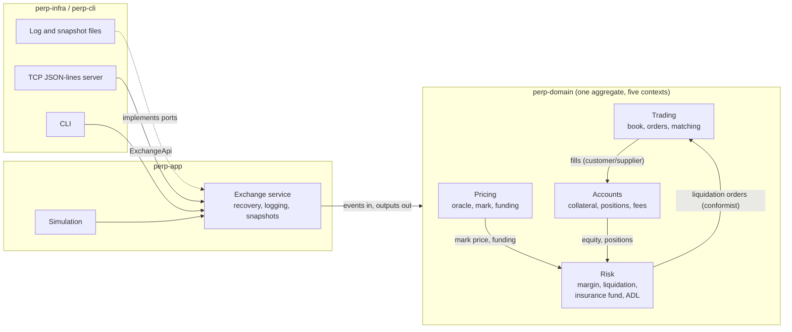

# Domain language and context map

The words below are used with exactly these meanings in the code, the tests and
the README. When a test name, a type name and a README sentence disagree, that
is a bug in one of them.

## Glossary

| Term | Meaning | Where |
|------|---------|-------|
| **Exchange** | The aggregate that owns every market, book, account and fund and is the only thing allowed to change them. | `engine::Engine` |
| **Event** | An input to the exchange, stamped with a time. Events are totally ordered. | `types::Event`, `EventBody` |
| **Output** | A fact the exchange emits while handling an event (domain event): `Accepted`, `Fill`, `Canceled`, `FundingSettled`, `LiquidationStarted`, ... | `types::Output` |
| **Rejection** | An event the exchange refuses. It changes nothing except the applied-event counter. | `error::Error` |
| **Halt** | Fail-stop after an internal inconsistency or an operator kill switch. Later events are refused. | `Engine::is_halted` |
| **Market** | One perpetual contract with a tick, a lot, a margin schedule and oracle/funding parameters. | `types::MarketConfig` |
| **Price / Qty / Money** | Fixed-point values: price 1e-6 quote per base unit, quantity 1e-4 base units, money 1e-6 quote units. No floating point anywhere. | `fixed` |
| **Price band** | Limit on how far from the mark a fill may execute: limit orders more aggressive than `mark * (1 ± band)` are rejected, market-order slippage is measured from the mark, and resting orders that drift out of the band are cancelled when the mark moves (`CancelReason::PriceBand`). | `MarketConfig::price_band_bps` |
| **Execution-price loss** | What an order would lose by trading at resting prices instead of the mark; reserved in the margin test at order entry. | `engine::orders` |
| **Precheck** | Look-up-only rejections that are refused before an event is logged. | `Engine::precheck` |
| **Read-only mode** | State of the service when the log is full: queries work, events are refused, nothing is half-applied. | `ServiceError::ReadOnly` |
| **Tick / Lot** | Smallest allowed price step and quantity step of a market. | `MarketConfig::tick`, `lot` |
| **Notional** | `price * quantity` in money units. | `fixed::notional` |
| **Order** | An instruction to buy or sell. Limit (GTC, IOC, FOK, post-only) or market (with a slippage limit). | `types::PlaceOrder` |
| **Resting order** | An order waiting on the book. | `book::Order` |
| **Maker / Taker** | The resting side / the incoming side of a fill. A fill executes at the maker's price. | `Output::Fill` |
| **Price-time priority** | Better price first; at equal price the older order first. | `book::Book` |
| **Self-trade prevention (STP)** | What happens when an order would match another order of the same account: cancel newest, cancel oldest, cancel both. | `types::StpMode` |
| **Reduce-only** | An order that may only shrink the account's position. | `PlaceOrder::reduce_only` |
| **Cancel-replace** | Changing price or quantity of a resting order. Priority is kept only if the price is unchanged and the quantity does not grow. | `EventBody::Replace` |
| **Account** | Owner of collateral, positions and orders. Cross-margined over all markets. | `account::Account` |
| **Collateral** | Deposits plus realised PnL, funding and fees. | `Account::collateral` |
| **Position** | Signed size in one market (positive long, negative short) with a cost basis. | `account::Position` |
| **Cost basis** | Money paid (long) or received (short, negative) for the open size. Makes realised PnL exact. | `Position::basis` |
| **Unrealised PnL** | Position value at mark minus cost basis. | `engine` |
| **Equity** | Collateral plus unrealised PnL of all positions. | `Engine::equity` |
| **Initial margin** | Equity an account must keep to open or grow exposure, and to withdraw. | `margin::MarginKind::Initial` |
| **Maintenance margin** | Equity below which an account is liquidated. | `MarginKind::Maintenance` |
| **Margin tier** | One marginal bracket of the margin schedule. | `types::MarginTier` |
| **Exposure** | Quantity of an account's non-reduce-only resting orders per side; counted at its worst case in margin checks. | `account::Exposure` |
| **Index price** | Filtered external price, set by oracle events. | `Engine::index_price` |
| **Mark price** | Median of index, book mid and last trade, clamped around the index. Used for margin and liquidation. | `Engine::mark_price` |
| **Oracle update** | An event carrying an index price and the time the source observed it. Checked for staleness and clamped to a maximum change. | `EventBody::Oracle` |
| **Premium** | `(mid - index) / index`, sampled at each oracle update. | `engine::pricing` |
| **Funding rate** | Mean premium plus interest, clamped, charged once per interval; positive means longs pay shorts. | `engine::funding` |
| **Funding carry** | The fraction of a money unit left over after splitting a funding payment, carried to the next interval. | `Output::FundingSettled::carry` |
| **Liquidation queue** | Accounts waiting for a maintenance check, served round-robin from a persistent cursor so that unfillable accounts cannot starve the rest. | `Engine` (`liq_cursor`) |
| **Liquidation step** | One chunk of a position sold by an immediate-or-cancel reduce-only order at the liquidation price. | `engine::risk` |
| **Liquidation price** | Mark moved by the liquidation band against the position, never worse than the bankruptcy price while the account is solvent. | `engine::risk` |
| **Bankruptcy price** | The price at which closing the position leaves the account with exactly zero equity. | `engine::risk` |
| **Insurance fund** | Exchange-owned money that pays the *realised* shortfall of liquidated accounts (never unrealised losses of open positions). Funded by liquidation fees and by `FundInsurance`. | `Engine::insurance_fund` |
| **Auto-deleveraging (ADL)** | Closing a bankrupt position against opposite positions at the bankruptcy price when the fund cannot cover the deficit. Counterparties are ranked by profit ratio, then size, then account id. | `Output::Deleveraged` |
| **Bad debt** | A loss nobody could cover. Reported, never hidden; non-zero means the venue is insolvent by that amount. | `Engine::bad_debt` |
| **Fee pool** | Fees collected minus maker rebates paid. | `Engine::fee_pool` |
| **Money identity** | `sum(collateral) + insurance + fee_pool - sum(cost basis) == net_deposits + bad_debt`, exactly, after every event. | `Engine::check_invariants` |
| **State hash** | SHA-256 over the canonical encoding of the whole state. | `Engine::state_hash` |
| **Content hash** | The state hash with the applied-event counter zeroed. | `Engine::content_hash` |
| **Event log (WAL)** | Append-only, hash-chained record of every event, written before the event is applied. | `perp_app::ports::EventLog` |
| **Snapshot** | Canonical encoding of the state at a sequence number, used to shorten recovery. | `perp_app::ports::SnapshotStore` |
| **Port / Adapter** | An interface the application needs (log, snapshots, clock, probe) / its implementation in `perp-infra` or an in-memory fake. | `perp_app::ports` |

## Bounded contexts

The exchange is **one aggregate** on purpose: the money identity spans every
context below, and only a single consistency boundary can check it after each
event. The contexts are modules with their own vocabulary and the relationships
shown.



| Context | Owns | Relationship |
|---------|------|--------------|
| Trading | books, orders, matching, self-trade prevention | Supplies fills to Accounts. Accepts liquidation orders from Risk as ordinary IOC orders (Risk is a conformist to Trading's rules). |
| Accounts | collateral, positions, cost basis, fees | Downstream of Trading's fills; upstream of Risk (equity and sizes). |
| Pricing | index, mark, premium samples, funding schedule | Upstream of Risk (mark price) and of Accounts (funding transfers). |
| Risk | margin schedule, liquidation, insurance fund, ADL | Downstream of Pricing and Accounts; issues orders into Trading. |
| Persistence (application + adapters) | event log, snapshots, recovery | Supporting context. Knows events and state only as opaque canonical bytes. |
| Access (adapters) | CLI, TCP protocol, authentication | Anti-corruption layer: translates JSON lines into events and outputs into JSON. |

## Layers and the dependency rule

```
perp-cli  ->  perp-infra  ->  perp-app  ->  perp-domain
 (binary)     (adapters)     (use cases)     (pure model)
```

Each arrow is a Cargo dependency, so the compiler rejects an inward layer that
imports an outward one. `perp-domain` has no dependencies at all.
`crates/perp-cli/tests/architecture.rs` additionally checks the manifests, the
absence of third-party crates and `#![forbid(unsafe_code)]` in every crate.
